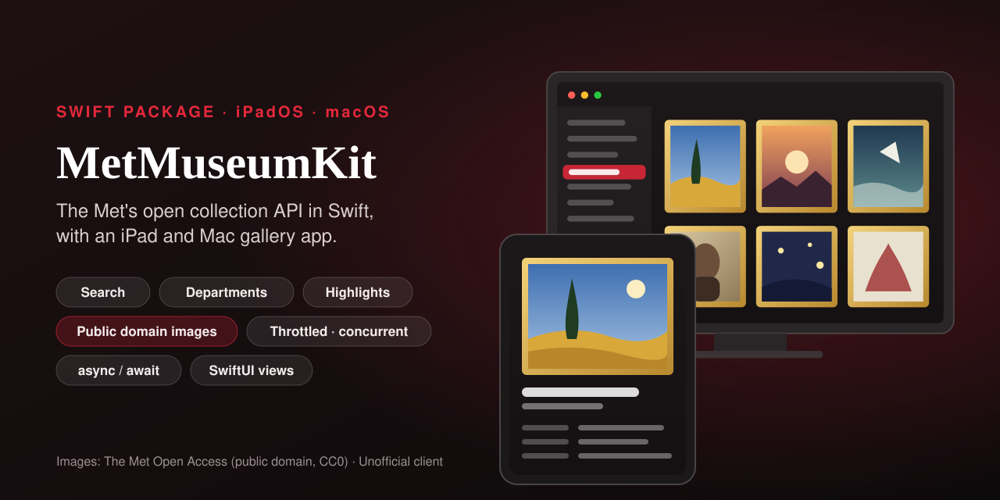
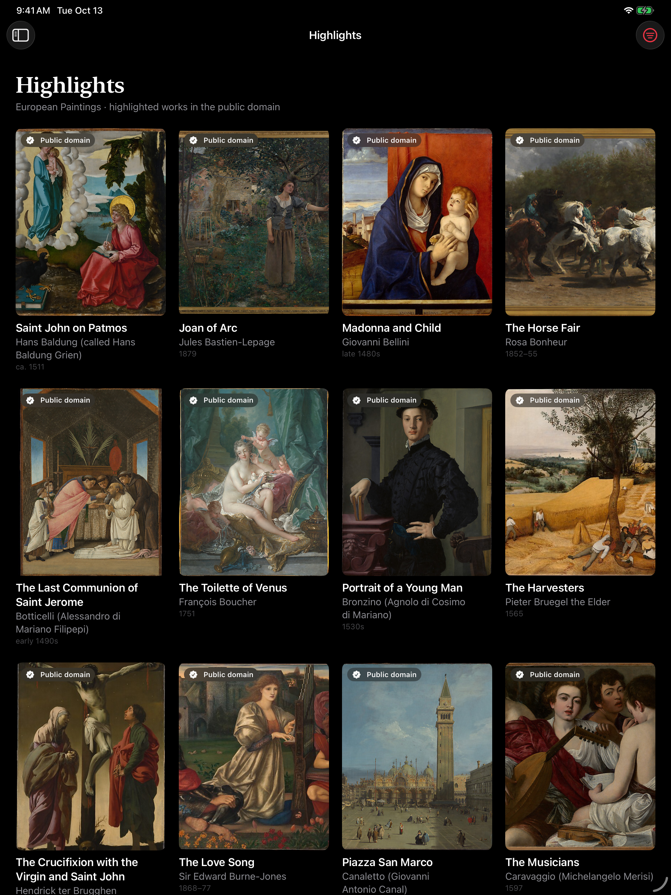
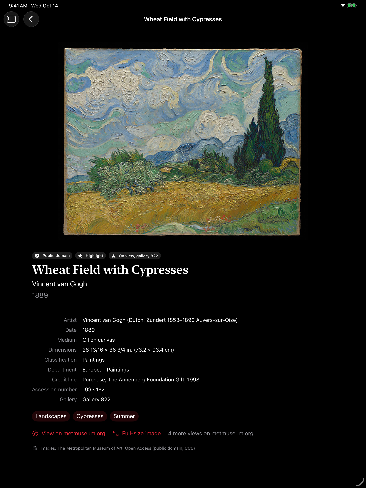
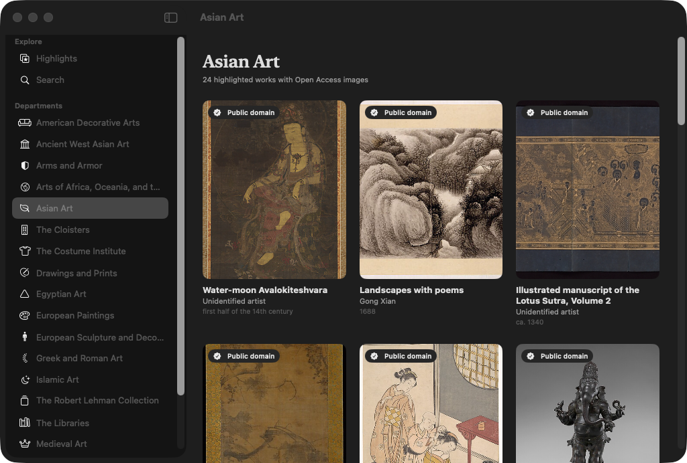
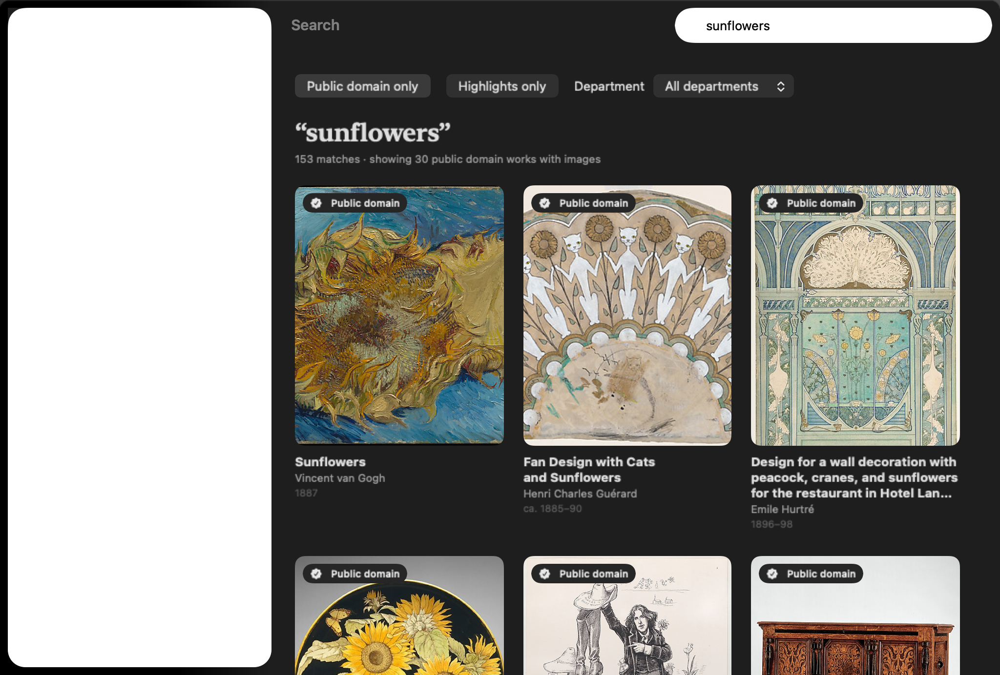

<p align="center">
  
</p>

<p align="center">
  <a href="https://github.com/halilozel1903/MetMuseumKit/actions/workflows/ci.yml"></a>
  
  
  
  
  
  <a href="LICENSE"></a>
</p>

**MetMuseumKit** is a Swift client for [The Metropolitan Museum of Art Collection API](https://metmuseum.github.io/), with SwiftUI views and a gallery app for **iPad and Mac**. Search with every filter the API has, browse the departments, fetch the works behind a list of IDs concurrently and in order, keep only the public-domain works that have images, and pick the right image size. Every request goes through a throttle that keeps you under the 80 requests per second The Met asks for. No API key, no dependencies.

```swift
import MetMuseumKit

let met = MetMuseumClient()

// Highlighted European paintings in the public domain, with images.
let paintings = try await met.highlights(departmentID: 11, limit: 24)
for painting in paintings {
    print(painting.displayTitle, painting.displayArtist ?? "", painting.imageURL(.small)!)
}

// Search returns IDs; objects(ids:) fetches the works, 6 at a time, in order.
let page = try await met.search(MetSearchQuery("sunflowers", hasImages: true))
let works = try await met.objects(ids: page.objectIDs)
let openAccess = works.publicDomainWithImages()

let wheatField = try await met.object(id: 436535)   // Wheat Field with Cypresses
wheatField.imageURL(.small)      // …/CRDImages/ep/web-large/DP-42549-001.jpg
wheatField.imageURL(.original)   // …/CRDImages/ep/original/DP-42549-001.jpg
```

## Screenshots

Captured by CI from the example app, *Met Gallery*, on an iPad simulator and on the Mac, with real data from the live collection API and real images from images.metmuseum.org. Nothing in these screenshots is bundled or made up.

| iPad: highlights | iPad: a work |
| :---: | :---: |
|  |  |





## Features

- **The whole collection API**: `departments()`, `objectIDs(departmentIDs:metadataDate:)`, `object(id:)` and `search(_:offset:limit:)`. See the table below.
- **Every search filter**: `MetSearchQuery` covers `q`, `isHighlight`, `hasImages`, `isOnView`, `departmentId`, `medium` and `geoLocation` (several values joined with `|`), `dateBegin`/`dateEnd` as one range (negative years are B.C.), and the `title`, `tags` and `artistOrCulture` field switches. Only the filters you set are sent.
- **The paginated search**: `search` uses `/v1.1/search`, which replaced `/v1/search` on October 1, 2026. Pages are `offset` and `limit` (up to 500); `searchPages(_:pageSize:)` is an `AsyncSequence` over every page, up to the API's 10,000-result cap. A search with no matches (`"objectIDs": null`) is an empty page.
- **Bounded concurrent fetching**: search and `/objects` return only IDs. `objects(ids:)` fetches the works with at most 6 requests in flight (configurable), returns them in the order of the IDs, fetches duplicates once, and skips IDs the API answers with 404, which happens for a few search results.
- **Throttling**: every request first takes a slot from `MetRequestThrottle`, spaced `1 / requestsPerSecond` apart (80 by default), so even a burst of concurrent requests stays under the API's limit. Busy answers (429, 502, 503, 504), timeouts and lost connections are retried with backoff, honoring `Retry-After`.
- **Public domain filter**: only Open Access works have images in the API. `searchObjects(_:limit:publicDomainOnly:requireImage:)` walks the result pages and fetches works until it has `limit` that are in the public domain and have an image. `highlights(departmentID:limit:)` does it for a department's highlights, and `publicDomainWithImages()` filters any list.
- **Image URL helpers**: `imageURL(.small)` is `primaryImageSmall` (the `web-large` rendition, about 1,000 pixels), `imageURL(.original)` is `primaryImage` (the full-size file); each falls back to the other. `additionalImageURLs(.small)` turns the full-size extra views into their web renditions, and `MetImageRendition` converts any images.metmuseum.org URL between `web-large` and `original`.
- **Typed, tolerant models**: `MetObject` has every field of the API under a Swift name (`artistWikidata_URL` is `artistWikidataURL`, `GalleryNumber` is `galleryNumber`), and reads records with `null` arrays, missing keys or numbers where strings should be without failing. Computed properties give you `displayTitle`, `displayArtist`, `displayDate`, `dateRange`, `place`, `tagTerms`, `webURL`, `primaryConstituent` and `overallMeasurement` in centimeters. The models are `Codable` and encode back to the API's shape.
- **Optional SwiftUI**: the `MetMuseumUI` library has `ArtworkCard` (tile or row), `ArtworkFacts` (the catalogue facts as a grid), `MetArtworkImage` with a swappable loader and an in-memory cache, `PublicDomainBadge` and `MetOpenAccessCredit`. The client works without it.
- **Testable and Swift 6 ready**: point the client at any `URLSession` and base URL. The package's own tests answer every request from a `URLProtocol` stub and hand-written fixtures, never the network. Tested with Swift Testing on macOS and on an iPad simulator.

## API coverage

| Endpoint | Method |
| --- | --- |
| `GET /v1/departments` | `departments()` → `[MetDepartment]` |
| `GET /v1/objects?departmentIds=&metadataDate=` | `objectIDs(departmentIDs:metadataDate:)` → `MetObjectIDList` |
| `GET /v1/objects/{objectID}` | `object(id:)` → `MetObject` |
| several `/v1/objects/{objectID}`, concurrently | `objects(ids:maxConcurrentRequests:)` → `[MetObject]` |
| `GET /v1.1/search?q=&isHighlight=&hasImages=&departmentId=&dateBegin=&dateEnd=&medium=&geoLocation=&isOnView=&title=&tags=&artistOrCulture=&offset=&limit=` | `search(_:offset:limit:)` → `MetSearchPage` |
| every page of a search | `searchPages(_:pageSize:)` → `MetSearchPages` (`AsyncSequence`), `collectIDs()` |
| a search, then its works, filtered | `searchObjects(_:limit:publicDomainOnly:requireImage:)` → `[MetObject]` |
| a department's public-domain highlights | `highlights(departmentID:limit:)` → `[MetObject]` |
| anything else | `get(_:query:as:)` decodes any path into your own `Decodable` |

## Installation

In Xcode choose **File › Add Package Dependencies…** and enter:

```
https://github.com/halilozel1903/MetMuseumKit
```

Or add it to `Package.swift`:

```swift
dependencies: [
    .package(url: "https://github.com/halilozel1903/MetMuseumKit", from: "1.0.0")
],
targets: [
    .target(name: "MyApp", dependencies: [
        .product(name: "MetMuseumKit", package: "MetMuseumKit"),
        .product(name: "MetMuseumUI", package: "MetMuseumKit"),   // optional SwiftUI views
    ])
]
```

## Usage

### Departments and objects

```swift
let met = MetMuseumClient.shared

let departments = try await met.departments()
departments.first { $0.id == 11 }?.displayName      // "European Paintings"

let ids = try await met.objectIDs(departmentIDs: [11])                  // every European painting
let changed = try await met.objectIDs(metadataDate: .now.addingTimeInterval(-7 * 86_400))

let work = try await met.object(id: 436535)
work.title                      // "Wheat Field with Cypresses"
work.artistDisplayName          // "Vincent van Gogh"
work.objectDate                 // "1889"
work.dateRange                  // 1889...1889
work.medium                     // "Oil on canvas"
work.isPublicDomain             // true
work.isHighlight                // true
work.galleryNumber              // "822"
work.overallMeasurement?.width  // 93.4 (cm)
work.tagTerms                   // ["Landscapes", "Cypresses", "Summer"]
work.webURL                     // the work's page on metmuseum.org
```

### Search

```swift
// Highlights of a department with images; q is optional on /v1.1/search.
let highlights = try await met.search(.highlights(departmentID: 6))
highlights.total                // every match
highlights.objectIDs            // the first 100

// Every filter.
let query = MetSearchQuery(
    "landscape",
    field: .title,              // or .tags, .artistOrCulture, .anywhere (default)
    isHighlight: true,
    hasImages: true,
    isOnView: true,
    departmentID: 11,
    medium: ["Paintings"],      // medium=Paintings; several values are joined with |
    geoLocation: ["France", "Paris"],
    dates: 1850...1900          // dateBegin=1850&dateEnd=1900; use -500 ... -300 for B.C.
)
let page = try await met.search(query, offset: 0, limit: 200)
if let next = page.nextOffset {
    let more = try await met.search(query, offset: next, limit: 200)
}

// Every page as an AsyncSequence, loaded as you iterate.
for try await page in met.searchPages(MetSearchQuery("armor", departmentID: 4), pageSize: 500) {
    print(page.offset, page.objectIDs.count, "of", page.total)
}
```

The API serves only the first 10,000 results of a query; a page past them throws `MetMuseumError.invalidRequest`. For the full collection, use `objectIDs()` or The Met's [Open Access dataset](https://github.com/metmuseum/openaccess).

### Fetching works concurrently

```swift
let page = try await met.search(MetSearchQuery("cat", hasImages: true), limit: 60)

// Up to 6 requests in flight, every one throttled, results in the order of the IDs.
let works = try await met.objects(ids: page.objectIDs)
let faster = try await met.objects(ids: page.objectIDs, maxConcurrentRequests: 12)

// Search, fetch and filter in one call: stops as soon as it has 30 Open Access works with images.
let cats = try await met.searchObjects(MetSearchQuery("cat"), limit: 30)
let all = try await met.searchObjects(MetSearchQuery("cat"), limit: 30, publicDomainOnly: false, requireImage: false)
```

### Images

```swift
work.hasPublicDomainImage          // isPublicDomain and a primary image
work.imageURL(.small)              // primaryImageSmall, for grids and lists
work.imageURL(.original)           // primaryImage, the full-size file (often several MB)
work.additionalImageURLs(.small)   // other views, as web renditions
work.allImageURLs(.small)          // the primary image first, then the others

let original = URL(string: "https://images.metmuseum.org/CRDImages/ep/original/DP-42549-001.jpg")!
MetImageRendition.webLarge.url(for: original)   // …/CRDImages/ep/web-large/DP-42549-001.jpg
MetImageRendition(of: original)                 // .original
```

### Throttling, retries and configuration

```swift
let met = MetMuseumClient(configuration: MetMuseumConfiguration(
    requestsPerSecond: 40,          // default 80, the API's limit; 0 turns throttling off
    maxConcurrentRequests: 8,       // default 6
    maxRetries: 3,                  // default 2, for 429, 502, 503, 504 and timeouts
    userAgent: "MyGallery/1.0",     // default: the system's
    timeout: 20
))
```

Share one client across your app so its throttle covers every request. `MetRequestThrottle` is public if you want to put your own calls through the same limiter.

### Errors

```swift
do {
    _ = try await met.object(id: 1_000_000_000)
} catch let error as MetMuseumError {
    switch error {
    case .notFound(let message, _): print(message ?? "")    // "ObjectID not found"
    case .http(let status, let message, _): break             // 403 when blocked, 429 when busy
    case .decoding(let type, let description): break
    case .transport(let urlError): break                       // offline, timed out, cancelled
    case .invalidResponse: break
    case .invalidRequest(let reason): break                    // a search page past 10,000 results
    }
}
```

### SwiftUI views

```swift
import MetMuseumKit
import MetMuseumUI

LazyVGrid(columns: [GridItem(.adaptive(minimum: 190))]) {
    ForEach(works) { ArtworkCard(object: $0, showsBadge: true) }   // image, title, artist, date
}
ArtworkCard(object: work, style: .row)

MetArtworkImage(object: work, size: .small, contentMode: .fit)    // with a placeholder while loading
ArtworkFacts(object: work)        // artist, date, medium, dimensions, credit line, accession number…
PublicDomainBadge()
MetOpenAccessCredit()             // "Images: The Metropolitan Museum of Art, Open Access (public domain, CC0)"
```

Images load through the `MetImageLoader` in the environment (by default `URLSession` with an in-memory cache). Swap it for your own cache:

```swift
ContentView()
    .metImageLoader(MetImageLoader { url in
        try await MyImageCache.shared.data(for: url)
    })
```

## Example app

The `Example` folder contains *Met Gallery*, built with MetMuseumKit and MetMuseumUI, with one set of views for both platforms:

- **iPad** (`MetGallery`): a split view with Highlights, Search and every department in the sidebar. Highlights opens on the public-domain highlights of European Paintings, with a menu to switch departments; every work opens its page with the image, badges, catalogue facts, tags and links to metmuseum.org and the full-size image.
- **Mac** (`MetGalleryMac`): the same browser in a Mac window: pick a department in the sidebar to see its highlights, or search with filters for public domain, highlights and department.

The project uses [XcodeGen](https://github.com/yonaskolb/XcodeGen) so no project file has to live in the repo:

```bash
brew install xcodegen
cd Example && xcodegen generate
open MetGallery.xcodeproj
```

Run `MetGallery` on an iPad simulator or `MetGalleryMac` on your Mac. The app always uses the live API. Launch with `-screenshot gallery|object` (iPad) or `-screenshot departments|search` (Mac) to open a fixed scene, as CI does for the screenshots above.

## Images and data

The images shown by the example app and in the README screenshots are **Open Access images from The Metropolitan Museum of Art, in the public domain under [Creative Commons Zero (CC0)](https://creativecommons.org/publicdomain/zero/1.0/)**. They are loaded live from images.metmuseum.org; none are stored in this repository apart from the screenshots. The API serves images only for Open Access works, which is why MetMuseumKit filters on `isPublicDomain`. The collection data comes from The Met's [Collection API](https://metmuseum.github.io/); please follow its terms and keep under 80 requests per second.

MetMuseumKit is an unofficial client. It is not affiliated with or endorsed by The Metropolitan Museum of Art. The JSON fixtures used by the unit tests are hand-written in the API's shapes; the app icon and banner are original artwork made for this package.

## Requirements

- Xcode 26 or later (Swift 6.2 toolchain)
- iPadOS 17+ or macOS 14+ (the client also runs on iOS 17+)

## Contributing

Issues and pull requests are welcome. Please run the tests before opening a PR:

```bash
swift test
bash scripts/test.sh iOS
```

## License

MetMuseumKit is available under the MIT license. See [LICENSE](LICENSE).
